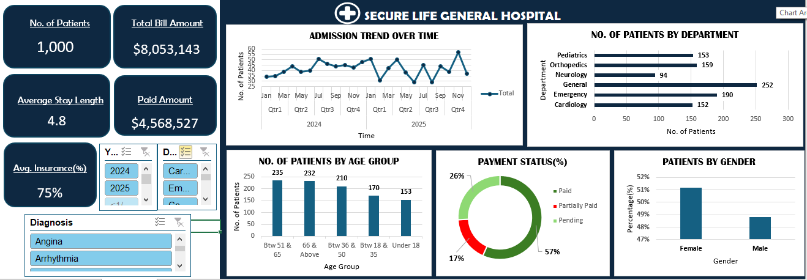

# HOSPITAL PATIENTS DATA ANALYSIS DASHBOARD

### Project Overview

This project focuses on analysing hospital patients' data using Microsoft Excel. The aim is to explore patient demographics, admission trends, departmental distribution, payment status and other important hospital metrics.
The project involved data cleaning, data analysis and visualization, culminating in the development of an interactive Excel dashboard to transform raw data into meaningful insights.
This project was completed as part of my Data Analytics training with FadaQa.

### Project Objectives

The main objectives of this project are:

- To clean and organise raw hospital patients' data.
- To analyse patient demographics and admission patterns.
- To identify the distribution of patients across hospital departments.
- To examine payment status and financial information.
- To develop an interactive dashboard using Microsoft Excel.
- To present meaningful insights through data visualization.

### Tools and Technologies Used

- Microsoft Excel
- Data Cleaning
- Pivot Tables
- Pivot Charts
- Excel Formulas and Functions
- Slicers
- Data Visualization

### Dashboard Features

The dashboard provides the following Key Performance Indicators (KPIs):
| KPI | Result |
|:---|---:|
| Total Number of Patients | 1,000 |
| Total Bill Amount | $8,053,143 |
| Average Stay Length | 4.8 |
| Paid Amount | $4,568,527 |
| Average Insurance | 75% |

### Dashboard Visualizations

The dashboard contains the following visualizations:
- Admission Trend Over Time: Shows patient admission patterns across months and quarters.
- Patients by Department: Shows the distribution of patients across hospital departments.
- Patients by Age Group: Displays the distribution of patients across different age categories.
- Payment Status: Illustrates the proportion of paid, partially paid and pending payments.
- Patients by Gender: Shows the distribution of male and female patients.
- Interactive Filters: Allows users to filter the dashboard by year, department and diagnosis.

### Dashboard Preview

### Key Insights and Findings

The dashboard provides several important observations about hospital operations:
- The General Department recorded the highest number of patients, with 252, while Neurology recorded the lowest, with 94.
- Patients aged between 51 and 65 constituted the largest age group, with 235 patients.
- The payment analysis indicates that 57% of payments were completed, while 17% were partially paid and 26% remained pending.
- Female patients accounted for a slightly higher proportion of the patient population than male patients.
- Patient admissions fluctuated across the observed months of 2024 and 2025.
- The dashboard recorded a total billed amount of $8,053,143, with $4,568,527 displayed as paid.
- These findings demonstrate how dashboard-based analysis can help summarize hospital activities and highlight areas that may require further investigation.

